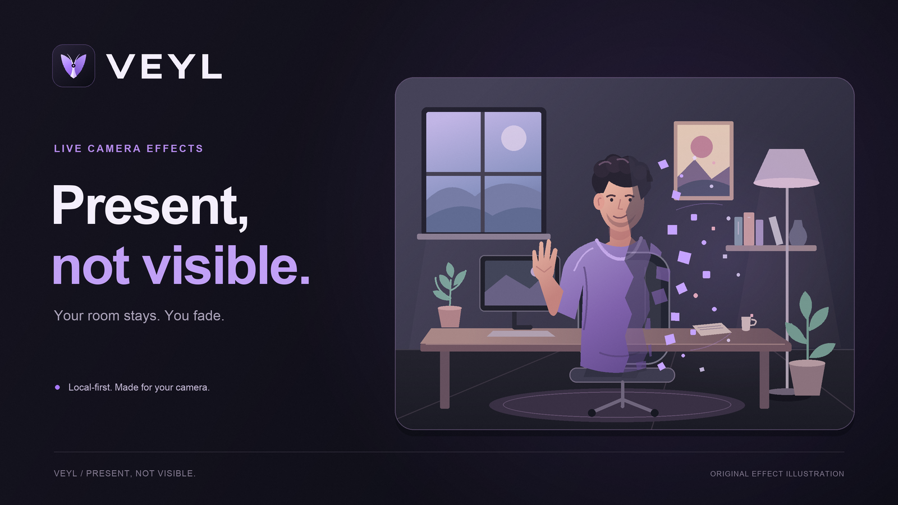

# Veyl brand and promotional artwork

**Present, not visible.** The identity pairs a violet, folded-veil **V** with an
obsidian rounded container. The two folds open around an absent center. The
lettering in the VEYL wordmark is original outlined geometry, independent of
installed fonts.



## Files and intended use

Dimensions are pixels for PNGs and native viewBox units for SVGs.

| File | Dimensions | Use |
| --- | --- | --- |
| `assets/brand/veyl-mark.svg` | 128 × 128 | Authoritative logo geometry, colors, and container; source of every icon |
| `assets/brand/veyl-mark.png` | 1024 × 1024 | High-resolution transparent logo for documentation/design use |
| `assets/brand/veyl-wordmark.svg` | 248 × 64 | Original outlined VEYL lettering used by promotional layouts |
| `public/icons/veyl-16.png` | 16 × 16 | Runtime extension icon |
| `public/icons/veyl-32.png` | 32 × 32 | Runtime extension icon |
| `public/icons/veyl-48.png` | 48 × 48 | Runtime extension icon |
| `public/icons/veyl-128.png` | 128 × 128 | Runtime extension icon |
| `assets/promotional/veyl-room.svg` | 900 × 720 | Shared original room, person, and dissolve illustration |
| `assets/promotional/veyl-cover.svg` | 1600 × 900 | Editable documentation-cover layout |
| `assets/promotional/veyl-cover.png` | 1600 × 900 | Documentation/social cover, 16:9 |
| `assets/promotional/veyl-cws-tile.svg` | 440 × 280 | Editable small store-tile layout |
| `assets/promotional/uploads/veyl-cws-tile.png` | 440 × 280 | Separate Chrome Web Store small promotional-tile upload |
| `assets/promotional/veyl-cws-marquee.svg` | 1400 × 560 | Editable wide store-marquee layout |
| `assets/promotional/uploads/veyl-cws-marquee.png` | 1400 × 560 | Separate Chrome Web Store marquee upload |

The five logo/icon PNGs are **RGBA**, with fully transparent outer corners,
partially transparent antialiased edges, and an opaque dark container. The three
promotional PNGs are **RGB**, completely opaque, with no transparency metadata.
Every size is rendered directly from vectors; small icons are not resizes of a
previously generated PNG.

Runtime files belong only in `public/icons/`. Promotional sources and cover
artwork live under `assets/promotional/`; final store-upload PNGs have their own
`uploads/` directory. Store promotional images are uploaded separately in the
store dashboard. They are not extension-manifest resources and require no
invented cover, tile, or marquee manifest keys.

## Source of truth and editing

```text
assets/brand/veyl-mark.svg ──────────────> four runtime icons + 1024px logo
             │
             ├──────────────────────────────┐
assets/brand/veyl-wordmark.svg ──────────────┤
assets/promotional/veyl-room.svg ────────────┤
                                           v
                             three promotional layout SVGs
                                           │
                             cover PNG + two upload PNGs
```

Each layout uses relative SVG `<image>` references to the same mark, wordmark,
and room masters. Those references remain vector sources, with no embedded
raster images. Keep the source directories together when opening or sharing the
SVGs. The PNGs are self-contained. If an SVG editor requires embedded artwork,
embed a copy for that editor rather than maintaining a second logo or room
design in this repository.

Edit the **SVG masters**, then regenerate the PNGs. Edit layout text/spacing in
the corresponding cover, tile, or marquee SVG. Edit the person or furniture once
in `veyl-room.svg` to update all three compositions. The generator reads these
files; it does not overwrite them or maintain a second hand-coded version of
their geometry.

The room illustration deliberately shows a recognizable face, curly hair,
sweatshirt folds, and an open hand. A solid half, translucent transition, missing
body regions, and individual violet fragments make the disappearance legible.
The window, monitor, desk, chair, lamp, shelf, books, and plants remain visible,
including through the disappearing part of the person. Fixed particle positions
are in the vector master, so all aspect ratios depict the same moment.

### Palette and proportions

| Role | Color |
| --- | --- |
| Obsidian | `#0d0d16` |
| Bright violet | `#a879ff` |
| Light violet | `#c1a0f6` |
| Logo highlight | `#d8c5ff` |
| Fold shadow | `#6b42bf` |
| Near-white lettering | `#f4effc` |

Preserve aspect ratios and the logo's transparent margin. Keep the two light
inner folds and small dark center at icon sizes. Use the dedicated layouts for
different aspect ratios so the person, room, and text remain legible.

## Reproduce

Requirements: **Python 3.10+ and Pillow 12.3.0**. Pillow is available in the
development environment. There are no added npm dependencies, downloads,
browser/converter requirements, or font files bundled with these assets.

From the repository root:

```sh
python3 scripts/generate-artwork.py
python3 scripts/generate-artwork.py --check
```

The first command writes exactly the eight PNGs listed above, creating the
upload directory if needed. It resolves input/output paths relative to the
script's repository, so it also works when invoked by absolute path from another
working directory. SVGs and documentation are maintained as text sources.

`--check` writes nothing. It re-renders every asset in memory and compares the
complete encoded PNG bytes with the files on disk. Missing/stale files cause a
nonzero exit. Each run also checks PNG integrity, dimensions, color mode, clear
logo corners, opaque logo centers, fractional alpha at edges, and opaque
promotional output. The console reports SHA-256 prefixes for assets and fonts.

### Fonts and deterministic output

The checked-in raster artwork uses installed **Arial regular and bold**:

| Face | Local path | SHA-256 prefix |
| --- | --- | --- |
| Regular | `/System/Library/Fonts/Supplemental/Arial.ttf` | `525979822591a344` |
| Bold | `/System/Library/Fonts/Supplemental/Arial Bold.ttf` | `d72db21f9242aedd` |

Automatic discovery checks macOS Arial, Linux Liberation Sans, Linux DejaVu
Sans, and Windows Arial, in that order; if none are available, Pillow's scalable
default font keeps generation portable. The wordmark and logo never use a font.
System font files are not copied into the project.

To explicitly select installed fonts:

```sh
python3 scripts/generate-artwork.py \
  --font-regular "/path/to/regular.ttf" \
  --font-bold "/path/to/bold.ttf"
python3 scripts/generate-artwork.py --check \
  --font-regular "/path/to/regular.ttf" \
  --font-bold "/path/to/bold.ttf"
```

Byte-for-byte reproduction requires the same source files, font files, Pillow
version, and compatible Python/FreeType rendering environment. Fallback fonts
can change promotional text metrics and hashes; they do not change the outlined
brand geometry. SVG layouts declare the matching Arial/Liberation Sans/DejaVu
Sans family stack with kerning disabled. When using a custom font, also update
that family declaration if matching the SVG's browser appearance is important.

Icons are supersampled **8×**; the large logo and promotional art are
supersampled **2×**. All are downsampled with Lanczos. Negligible alpha ringing
is trimmed at the transparent container edge. Promotional PNGs get subtle
one-code-value luminance dithering, using a private seeded RNG with base seed
`0x5645594c`, combined with the stable output-path hash. This avoids banding
without changing the SVG geometry or particle positions. There are no timestamps,
network inputs, or nondeterministic PNG metadata.

The renderer intentionally supports the SVG vocabulary used here: basic shapes,
absolute `M/L/H/V/C/Q/Z` paths without holes, translation and positive scaling,
groups and opacity, local `<use>`, relative SVG `<image>` references,
`userSpaceOnUse` linear/radial gradients, clip paths, and single-line text.
Unsupported elements, inline CSS, filters, masks, and compound fill rules fail
explicitly. Keep edits within this vocabulary or extend the renderer alongside
the source change. No general-purpose SVG package is required.

## Originality and actual screenshots

The mark, outlined wordmark, room, person, furniture, landscape geometry,
particles, and compositions were authored specifically for Veyl in this
repository. No stock photos, traced logos, copied characters, downloaded textures,
or other third-party copyrighted artwork are used or bundled. Ordinary text is
rendered with existing installed fonts; their font files are not redistributed.

These are **promotional illustrations**, not screenshots of the extension or
evidence that a particular website or remote camera output was verified. Actual
screenshots must still be captured manually in the browser, using a real Veyl
session. Keep those captures distinct from `uploads/` promotional artwork and
label them with the tested site/state. Do not substitute these illustrations for
required product screenshots or for manual camera/WebRTC verification.
